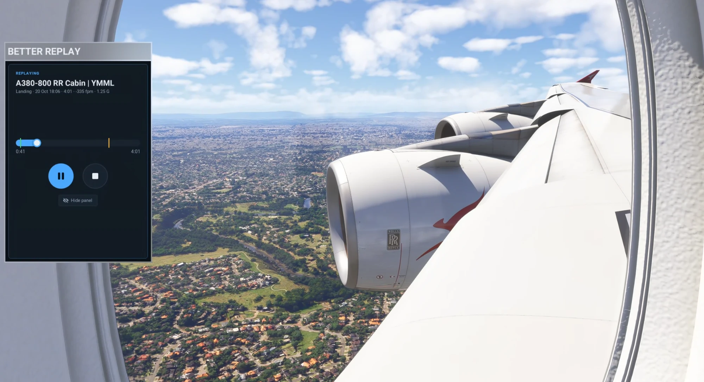
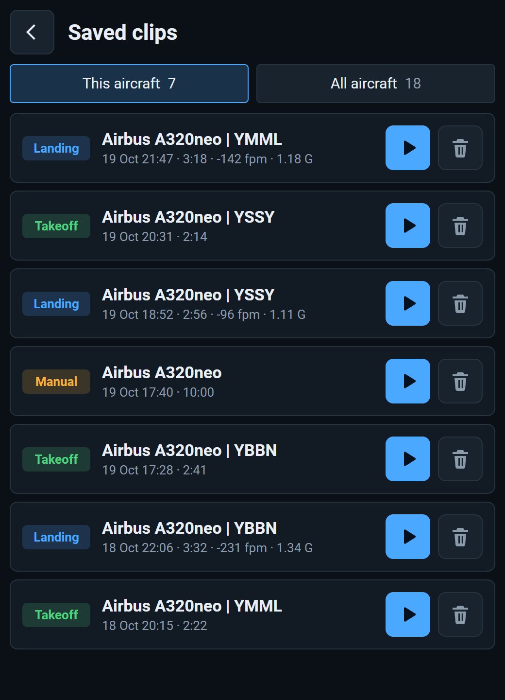
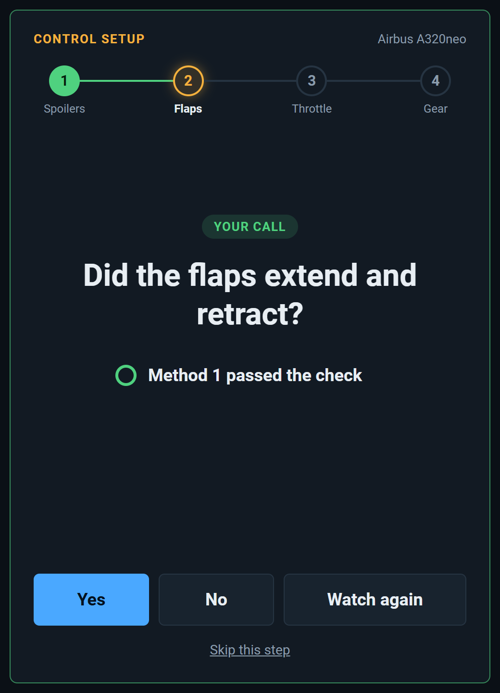

# BetterReplay

An auto replay recorder for Microsoft Flight Simulator 2024. It records your flight in the background, saves every takeoff and landing as a clip, and lets you replay them on your own aircraft from a toolbar panel.

  

I made it because the replay tools I'd used needed an external helper running alongside the sim. BetterReplay is a single folder you drop into Community, and everything runs inside the sim. It keeps a rolling record of the last 10 minutes of your flight and saves your takeoffs and landings without you doing anything.

The other big reason was getting the animations right. Other replay tools didn't handle flaps, gear, spoilers and reversers well. Many aircraft work these controls their own way, so BetterReplay learns each aircraft. In a short guided control setup you move each control, BetterReplay replays your movement and asks whether it worked, and it remembers what did. That way you can "teach" it aircraft I haven't made a profile for.

  
  

## Features

- **Automatic clips** of every takeoff and landing. Landings show touchdown vertical speed, peak G and bounces.
- **Always recording** the last 10 minutes of your flight, whether or not the panel is open.
- **Learns new aircraft:** a short guided setup per aircraft teaches it how to move its spoilers, flaps, throttle, reversers and gear, so replays look right even on 3rd party aircraft with custom animations.
- **Fly-by-wire control surfaces:** on aircraft whose fly-by-wire moves the elevator, ailerons and rudder itself, a replay steers them to the clip's through the stick and pedals, the way your joystick moves them.

## Aircraft

Any aircraft can be taught with the control setup. **Included** means BetterReplay comes with the aircraft's control profile, so it replays right away without the setup. The known issues are in [KNOWN_ISSUES.md](KNOWN_ISSUES.md).

| Aircraft                                | Included | Additional info                |
| --------------------------------------- | -------- | ------------------------------ |
| iniBuilds A320neo V2 / A321LR (default) | ✅       |                                |
| iniBuilds A330 (default)                | ✅       |                                |
| Working Title 787-10 (default)          | ✅       |                                |
| Working Title 747-8 (default)           | ✅       |                                |
| iniBuilds A340                          | ✅       |                                |
| iniBuilds A350                          | ✅       |                                |
| iniBuilds A380                          | ✅       |                                |
| Fenix A320 Family                       | ✅       |                                |
| FlyByWire A32NX (A320neo)               | ✅       |                                |
| FlyByWire A380X                         | ✅       |                                |
| Synaptic A220                           | ✅       |                                |
| FlightSim Studio E-Jets                 | ✅       |                                |
| PMDG 737                                | ✅       |                                |
| PMDG 777                                | ✅       |                                |

## Install

1. Download `betterreplay-recorder-<version>.zip` from the latest [release](https://github.com/jtsorlinis/BetterReplay/releases). To build it yourself, see [Building from source](#building-from-source).
2. Extract it into your Community folder, so you have `Community\betterreplay-recorder`. Unless you moved it, that's `%APPDATA%\Microsoft Flight Simulator 2024\Packages\Community` on Steam, or `%LOCALAPPDATA%\Packages\Microsoft.Limitless_8wekyb3d8bbwe\LocalCache\Packages\Community` for the Microsoft Store version. To update, delete the old `betterreplay-recorder` folder first.
3. Start the sim. If the BetterReplay icon isn't on the toolbar, enable it in the toolbar's settings.

## Recording

Recording starts once you're in a flight. Clips appear in the panel a few seconds after each takeoff or landing ends:

- **Takeoff:** from 30 seconds before you roll onto the runway until the flaps are up (or 2 minutes after liftoff if you took off without flaps).
- **Landing:** from 3 minutes before touchdown until you stop or leave the runway. Bounces stay part of the same landing; a touch-and-go or go-around ends it.

Nothing is detected for the first 10 seconds of a flight, so spawning on a runway or in the air never makes a clip. Recording pauses while the sim is paused, in slew, in the menus, during the sim's own replay, and while a clip plays.

## Where clips are kept

- **Steam:** `%APPDATA%\Microsoft Flight Simulator 2024\WASM\MSFS2024\betterreplay-recorder\work\`
- **Microsoft Store:** `%LOCALAPPDATA%\Packages\Microsoft.Limitless_8wekyb3d8bbwe\LocalState\WASM\MSFS2024\betterreplay-recorder\work\`

The newest 10 takeoff and landing clips of each aircraft are kept, and older ones are deleted automatically. "Save last 10 minutes" clips (about 5.5 MB each) are never deleted automatically.

## Troubleshooting

- **No toolbar icon:** enable it in the toolbar's settings. If it's still missing, the package was built without its panel (see [Building from source](#building-from-source)); clips are still saved.
- **Leave your joystick and pedals alone while a clip plays:** on fly-by-wire aircraft the replay steers the control surfaces through them, and moving them fights it. The first time an aircraft takes its surfaces back, a replay steers them from that moment on, and from the start of every replay after that.
- **Play says the engines aren't running:** a replay moves the thrust levers but can't start the engines, so an engine that's off stays off all through it, with no thrust or sound. Start them first for the replay to look right, or play it anyway.
- **Something went wrong:** the log is `betterreplay.log` in the clips folder above, and `betterreplay.prev.log` is the previous sim session's. Include it when you report a problem.

## Planned

- **Lights on all aircraft.** Nav, beacon, strobe, landing and taxi lights replay through the sim's own light events, which not every aircraft responds to.
- **Manual recording:** start and stop a clip yourself, so a whole flight can be recorded (_Save last 10 minutes_ only keeps the last 10 minutes).
- **Weather and time of day** from the clip.

## Building from source

You need the MSFS 2024 SDK, Visual Studio 2022 (or its Build Tools) with the C++ workload, and Node.js 22.13 or later. The first time, close the sim and run `.\build.ps1 -Package`: that also compiles the toolbar panel, starting the sim in package-builder mode to do it. After that, `.\build.ps1 -Install` builds BetterReplay and copies it into your Community folder.

## License

[MIT](LICENSE). You can use, change and share BetterReplay, as long as you keep the copyright and license notice.
