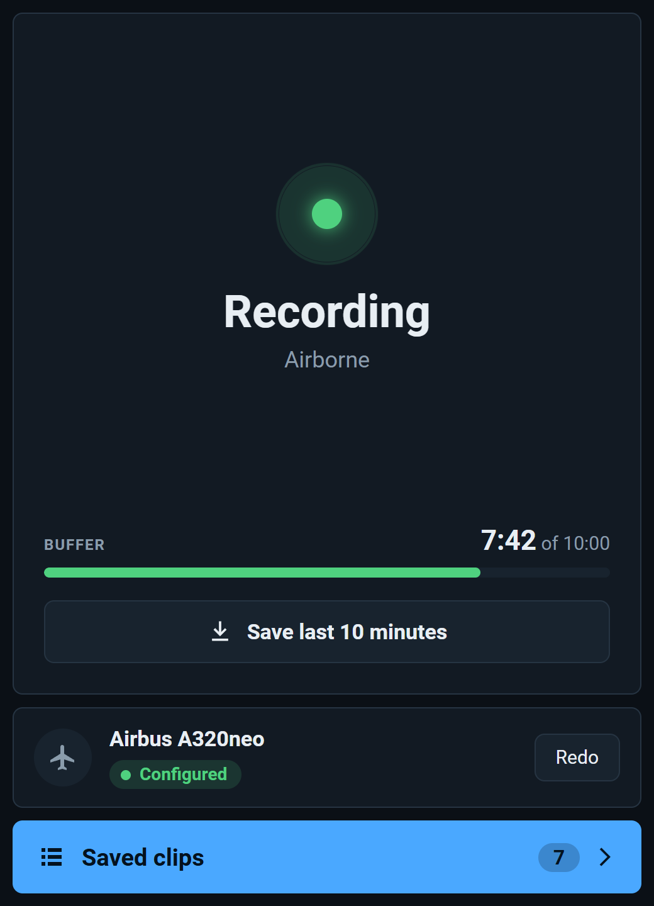
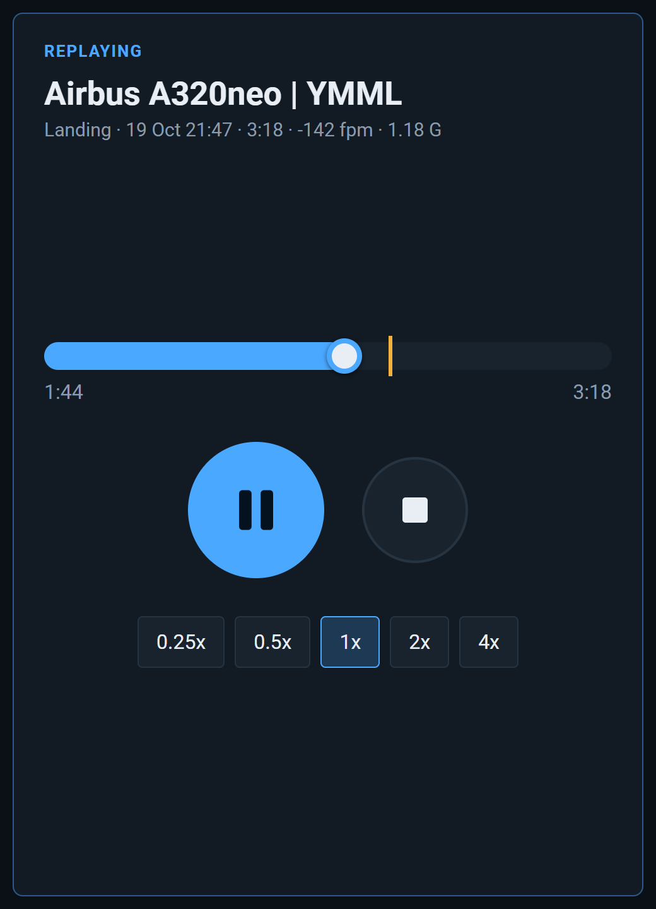
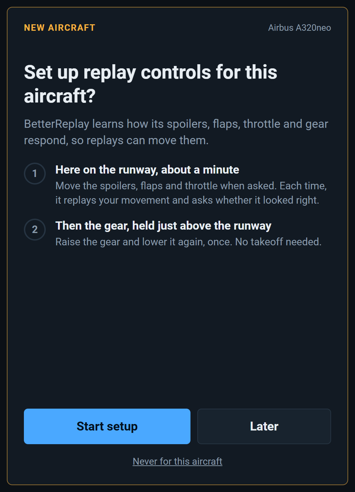

# BetterReplay

An auto replay recorder for Microsoft Flight Simulator 2024. It records your flight in the background, saves every takeoff and landing as a clip, and lets you replay them on your own aircraft from a toolbar panel.

  
  
  

I made it because the replay tools I'd used needed an external helper running alongside the sim. BetterReplay is a single folder you drop into Community, and everything runs inside the sim. It keeps a rolling record of the last 10 minutes of your flight and saves your takeoffs and landings without you doing anything.

The other big reason was getting the animations right. Other replay tools didn't handle flaps, gear, spoilers and reversers well. Many aircraft work these controls their own way, so BetterReplay learns each aircraft. In a short guided control setup you move each control, BetterReplay replays your movement and asks whether it worked, and it remembers what did. That way you can "teach" it aircraft I haven't made a profile for.

  
  

## Features

- **Automatic clips** of every takeoff and landing. Landings show touchdown vertical speed, peak G and bounces.
- **Always recording** the last 10 minutes of your flight, whether or not the panel is open.
- **Learns new aircraft:** a short guided setup per aircraft teaches it how to move its spoilers, flaps, throttle, reversers and gear, so replays look right even on 3rd party aircraft with custom animations.

## Install

1. Download `betterreplay-recorder-<version>.zip` from the latest [release](https://github.com/jtsorlinis/BetterReplay/releases). To build it yourself, see [Build and install](DEVELOPMENT.md#build-and-install).
2. Extract it into your Community folder, so you have `Community\betterreplay-recorder`. On Steam that's `%APPDATA%\Microsoft Flight Simulator 2024\Packages\Community` unless you moved it. To update, delete the old `betterreplay-recorder` folder first.
3. Start the sim. If the BetterReplay icon isn't on the toolbar, enable it in the toolbar's settings.

## Recording

Recording starts once you're in a flight. Clips appear in the panel a few seconds after each takeoff or landing ends:

- **Takeoff:** from 30 seconds before you roll onto the runway until the flaps are up (or 2 minutes after liftoff if you took off without flaps).
- **Landing:** from 3 minutes before touchdown until you stop or leave the runway. Bounces stay part of the same landing; a touch-and-go or go-around ends it.

Nothing is detected for the first 10 seconds of a flight, so spawning on a runway or in the air never makes a clip. Recording pauses while the sim is paused, in slew, in the menus, during the sim's own replay, and while a clip plays.

## Where clips are kept

`%APPDATA%\Microsoft Flight Simulator 2024\WASM\MSFS2024\betterreplay-recorder\work\` (Steam)

The newest 10 takeoff and landing clips of each aircraft are kept, and older ones are deleted automatically. "Save last 10 minutes" clips (about 5.5 MB each) are never deleted automatically.

## Troubleshooting

- **No toolbar icon:** enable it in the toolbar's settings. If it's still missing, the package was built without its panel (see [Build and install](DEVELOPMENT.md#build-and-install)); clips are still saved.
- **Something went wrong:** the log is `betterreplay.log` in the folder above, and `betterreplay.prev.log` is the previous sim session's. Include it when you report a problem.

## Development

Building from source, how it works, configuration and known gaps are in [DEVELOPMENT.md](DEVELOPMENT.md). [MANUAL_TEST.md](MANUAL_TEST.md) is the in-sim test checklist. [NOTES.md](NOTES.md) has the open bugs, the wishlist and which aircraft have been tested.

## License

[MIT](LICENSE). You can use, change and share BetterReplay, as long as you keep the copyright and license notice.
